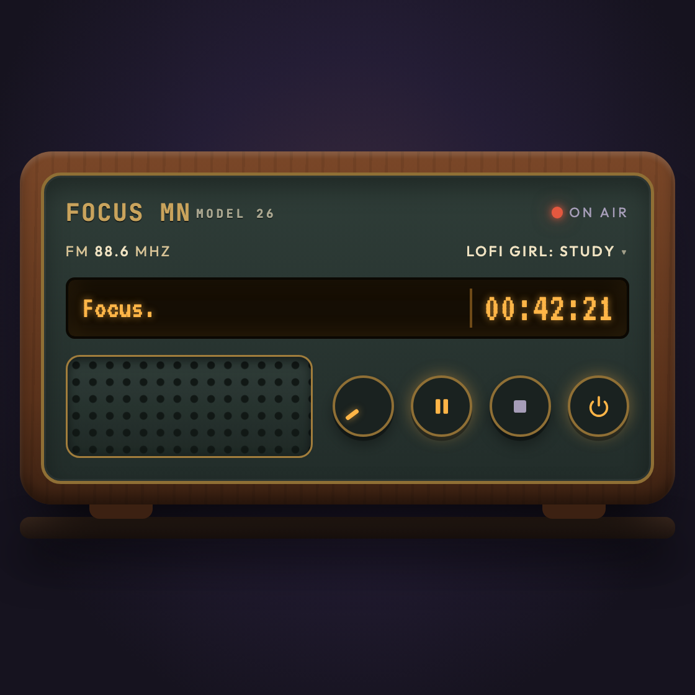
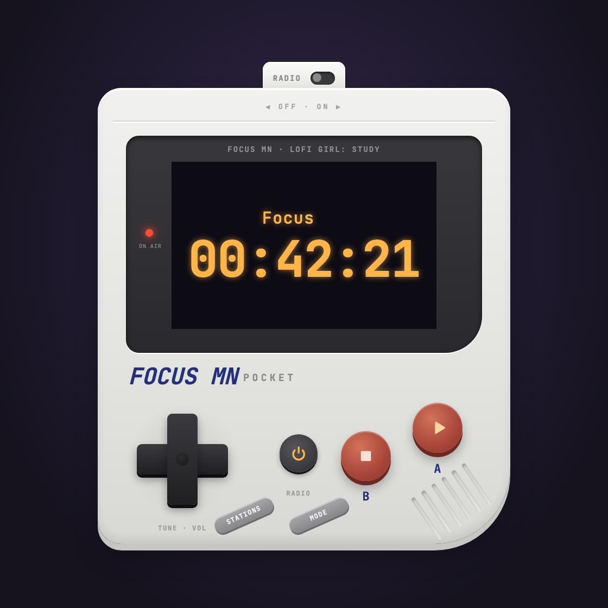
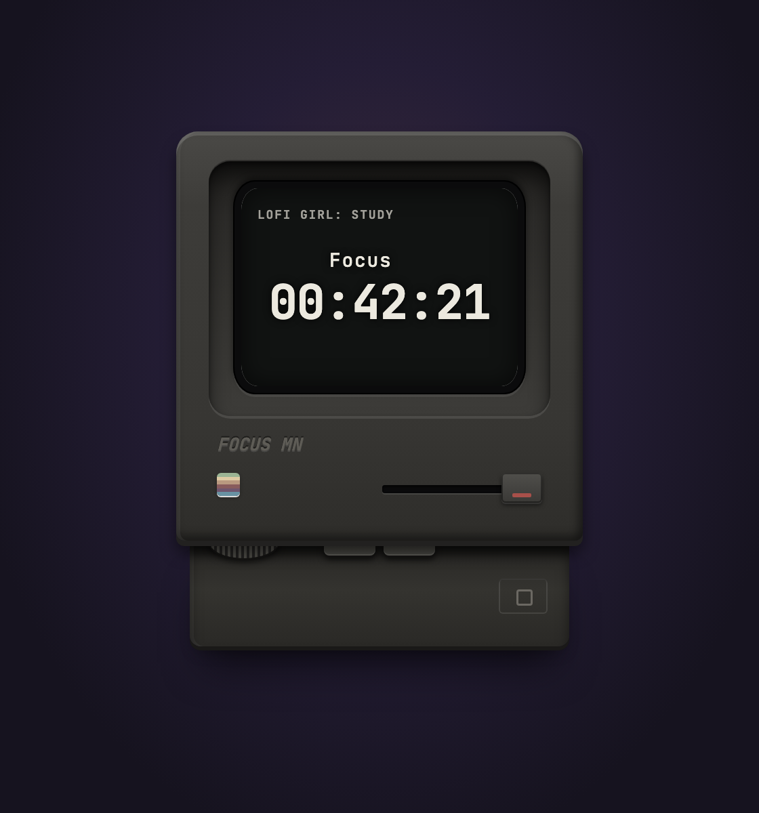

# Focus MN

A small floating study radio for macOS: a focus timer with Pomodoro, lofi live streams from YouTube, a study log, and a few retro skins. It sits above your other windows, and most controls also live in the menu bar.

<p>
  
  
  
</p>

## Features

- **Timer:** count up, or Pomodoro blocks of 20, 40 or 60 minutes with 5 or 10 minute breaks. When a block ends you get a chime and a notification, then the widget asks what the session was and whether to take a break.
- **Radio:** ten lofi live streams (Lofi Girl, Chillhop and others). Pick a station on the widget or from the menu bar. When a stream's ID changes, the app finds the current one.
- **Study log:** every session over a minute is logged by topic. Open Logs shows totals by day, week, month or a custom range, and can export to CSV.
- **Skins:** Walnut, Mint, Midnight, Cherry, FOCUS MN Pocket and FOCUS MN Classic, some with dark versions. Three sizes (XS, Small, Medium).
- **Menu bar:** start, pause and stop, the running time next to the icon, station, timer mode, size, skin and Keep on Top.

## Install

Needs macOS 13 or later.

1. Download `Focus-MN.zip` from the [Releases](../../releases) page and unzip it.
2. Move `Focus MN.app` to your Applications folder.
3. The app isn't notarized by Apple, so the first time, right-click it and choose **Open**, then **Open** again. If macOS still refuses, run this once:

   ```bash
   xattr -cr "/Applications/Focus MN.app"
   ```

Focus MN has no Dock icon. Look for the radio icon in the menu bar.

## Build from source

Needs the Xcode Command Line Tools (`xcode-select --install`).

```bash
git clone <this repo's URL>
cd focus-mn
./build.sh
open "build/Focus MN.app"
```

`./build.sh --zip` also makes `build/Focus-MN.zip` for a release. An app you build yourself doesn't get the warning above.

## Where your data lives

Everything is stored in `~/Library/Application Support/Focus MN/`:

- `Study Log.json`: your sessions
- `studyradio.state.json`: timer, skin, station, size and volume

To keep the log somewhere else, such as a synced notes folder, set the folder and restart the app:

```bash
defaults write local.focusmn.app LogFolder "~/Documents/Notes/Study"
```

To go back to the default folder, run `defaults delete local.focusmn.app LogFolder`.

## About the YouTube streams

Focus MN plays public YouTube live streams through YouTube's official embedded player, and finds each stream's current ID by reading the channel's public Live page. This is a personal hobby project and isn't affiliated with YouTube or any of the channels. Two things to know:

- The player is smaller than YouTube's recommended minimum size, and the timer is drawn over the video. That doesn't follow YouTube's embed guidelines.
- The stream lookup depends on how YouTube's pages are built, so it can break when YouTube changes them.

All music belongs to its creators. If you enjoy a station, go support the channel.

## Use it in a browser

`src/widget.html` also runs in a browser, where data is kept in the browser's local storage. YouTube refuses to play from `file://` pages, so serve it:

```bash
python3 -m http.server 8765 --directory src
```

Then open http://127.0.0.1:8765/widget.html.

## Contributing

See [CONTRIBUTING.md](CONTRIBUTING.md) for how the app fits together, the design rules and known pitfalls.

## License

[MIT](LICENSE)
