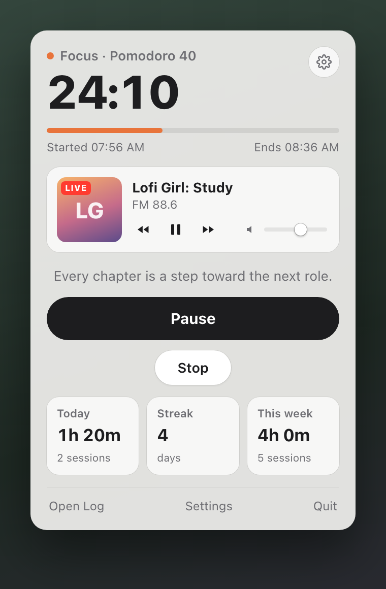
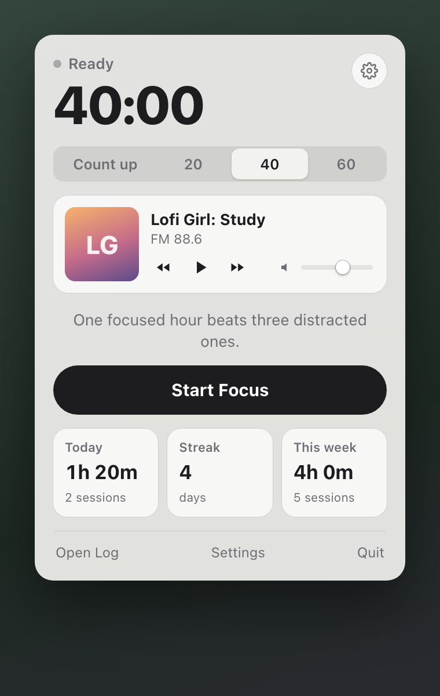
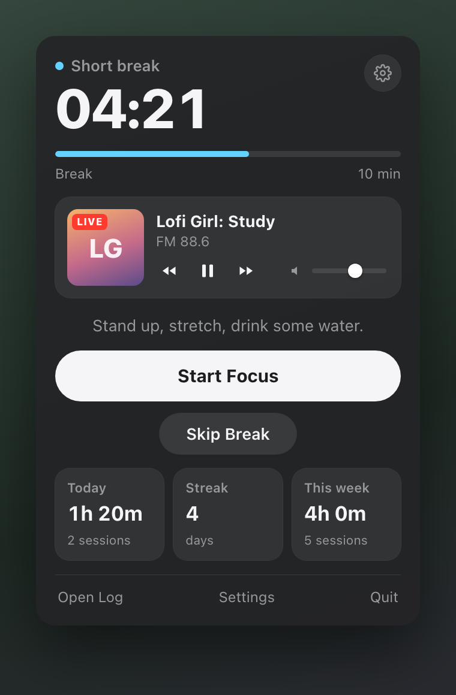
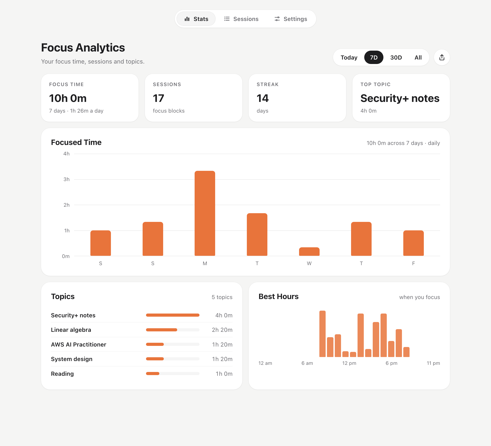
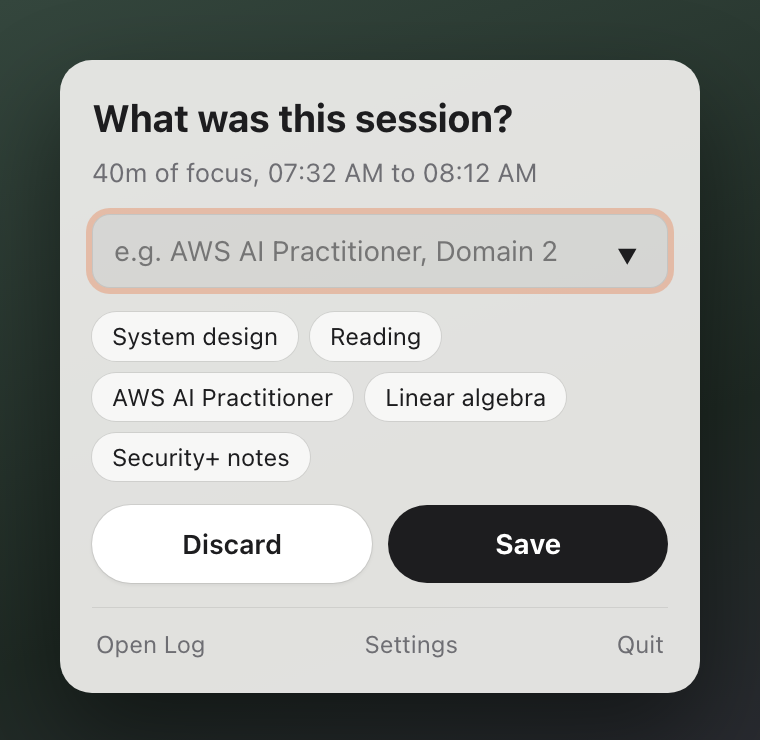

# Focus MN

A focus timer and lofi radio that lives in your Mac's menu bar. Click the time in the menu bar to open the timer: Pomodoro or count-up, a live lofi station, and today's focus at a glance. Every session is logged by topic, and a dashboard shows where your time went.

**[Download Focus MN for macOS](https://github.com/manojitnath/focus-mn/releases/latest/download/Focus-MN.zip)** (macOS 13 or later, see [Install](#install))

<p>
  
  
  
</p>

<p>
  
</p>

## Features

- **Lives in the menu bar.** The running time sits next to a timer icon, with a filling circle (◔ ◑ ◕) for Pomodoro blocks. Click it to open the panel; click anywhere else to close it.
- **Timer:** count up, or Pomodoro blocks of 20, 40 or 60 minutes with a 5 or 10 minute break. When a block ends you get a chime and a notification, and the panel opens to ask what the session was, then whether to take the break.
- **Radio:** ten lofi live streams (Lofi Girl, Chillhop and others), with previous, play/pause, next and volume right in the panel. It keeps playing when the panel is closed.
- **Study log:** every session over a minute is saved with its topic. Recent topics are one click away.
- **Dashboard:** focus time, sessions, streak and top topic for today, 7 days, 30 days or all time; a focused-time chart; time by topic; the hours you focus best; and a full session list you can tidy up. Export to CSV, or copy today's hours.
- **Shortcut:** ⌃⌥Space (Control-Option-Space) starts or pauses the timer from any app.
- **Open at login**, light and dark mode, and an update notice when a new version is out.

<p>
  
</p>

## Install

1. [Download `Focus-MN.zip`](https://github.com/manojitnath/focus-mn/releases/latest/download/Focus-MN.zip) and unzip it.
2. Move `Focus MN.app` to your Applications folder.
3. The app isn't notarized by Apple, so the first time, right-click it and choose **Open**, then **Open** again. If macOS still refuses, run this once:

   ```bash
   xattr -cr "/Applications/Focus MN.app"
   ```

Focus MN has no Dock icon: look for the timer icon in the menu bar. Right-click it for a small menu (Open Log, Settings, Check for Updates, Quit).

## Updates

Focus MN checks for a new release when it opens and once a day, and tells you with a notification. **Check for Updates…** is in the right-click menu and in Settings. To update, quit Focus MN, replace the app in Applications and open it again. Your log and settings are kept.

## Where your data lives

Everything is in `~/Library/Application Support/Focus MN/`:

- `Study Log.json`: your sessions
- `studyradio.state.json`: timer mode, station, volume

To keep the log somewhere else, such as a synced notes folder, choose a folder in **Settings → Your log**. Your current log is copied there if the folder doesn't have one yet.

## About the YouTube streams

The radio plays public YouTube live streams through YouTube's official embedded player, shown small as the station art, and finds each stream's current ID by reading the channel's public Live page. It's a personal project, not affiliated with YouTube or the channels. The small player doesn't follow YouTube's size guidelines, and the stream lookup can break when YouTube changes its pages. All music belongs to its creators.

## Build from source

Needs the Xcode Command Line Tools (`xcode-select --install`).

```bash
git clone https://github.com/manojitnath/focus-mn.git
cd focus-mn
./build.sh --install
```

This builds the app and copies it to `/Applications`. `./build.sh --zip` also makes `build.noindex/Focus-MN.zip` for a release. See [CONTRIBUTING.md](CONTRIBUTING.md) for how it fits together.

## License

[MIT](LICENSE)
